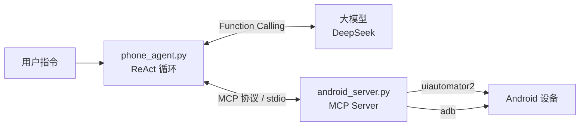

# Android Agent：基于 MCP 的 Android 设备操作智能体

用一句自然语言驱动 Android 设备完成多步操作。Agent 自主读取屏幕、规划步骤、调用工具，直到任务完成。

```
$ python phone_agent.py "打开设置，开启深色主题（Dark theme）"

第 1 步：open_app(com.android.settings)      → 返回设置首页元素
第 2 步：tap_element(16) Display & touch      → 读到 "Dark theme（已关闭）"
第 3 步：tap_element(13) Dark theme           → 读到 "Dark theme（已开启）"

最终回答：深色主题已开启。依据：开关状态由"已关闭"变为"已开启"。
```

## 特性

- **手写 ReAct 循环**：不依赖 Agent 框架，完整实现"思考 → 调用工具 → 观察结果"的决策循环，带最大步数保护和工具异常兜底
- **MCP 标准工具层**：设备操作能力封装为独立的 MCP Server，任何支持 MCP 的客户端（Claude Desktop、Cursor 等）都可直接接入
- **结构化 UI 感知**：基于界面层级树而非截图，输出元素编号、文字、可点击性、开关状态、输入框、滑块等信息
- **自建评测体系**：15 条任务评测集 + 批量评测脚本 + 失败分类，经过三轮"评测 → 归因 → 修复"迭代

## 架构



- **phone_agent.py**：同时承担 MCP Host 与 Client。启动 Server、获取工具清单并转换为模型可用的格式、驱动 ReAct 循环、转发工具调用
- **android_server.py**：MCP Server。读屏使用 uiautomator2 导出界面层级树；点击、输入、滑动等操作通过 adb 执行
- **run_eval.py**：批量评测。每条任务前重置设备状态，记录轮次、Token、耗时、完整日志，汇总为 CSV

## 技术栈

Python · MCP Python SDK（FastMCP）· OpenAI SDK（接入 DeepSeek）· uiautomator2 · ADB · asyncio

## 工具清单

| 工具 | 作用 |
|---|---|
| `get_screen_elements` | 读取当前屏幕元素：编号、文字、可点击、开关/选中状态、输入框、滑块 |
| `tap_element` | 按编号点击元素（实际点击其最近的可点击父节点） |
| `tap_slider` | 将滑块调到指定百分比 |
| `input_text` | 在当前输入框输入文字 |
| `swipe` | 上下滑动屏幕 |
| `press_key` | 返回 / Home / 回车 |
| `find_app` | 按关键词查找应用包名 |
| `open_app` | 打开应用（未安装时返回明确提示） |

除 `get_screen_elements` 和 `find_app` 外，所有操作类工具执行后都会**自动附带操作后的屏幕**，省去单独读屏的一轮往返。

## 目录结构

```
agent-demo/
├── phone_agent.py      # Agent：ReAct 循环 + MCP Client
├── android_server.py   # MCP Server：设备操作工具
├── run_eval.py         # 批量评测脚本
├── tasks.json          # 评测任务集
├── requirements.txt    # 依赖清单
├── eval_results/       # 每轮评测结果（CSV + 每条任务的完整日志）
└── learning/           # 学习过程中的练习代码（工具调用、ReAct 原型、最简 MCP Server）
```

## 快速开始

**环境要求**：Python 3.10+、Android 模拟器或真机（已开启 USB 调试）、adb、DeepSeek API Key

```bash
# 1. 创建并激活虚拟环境
python -m venv venv
source venv/bin/activate

# 2. 安装依赖（在 venv 中）
python -m pip install openai python-dotenv uiautomator2 "mcp[cli]<2"

# 3. 配置 API Key：在项目根目录创建 .env 文件
echo 'DEEPSEEK_API_KEY=你的key' > .env

# 4. 确认设备在线
adb devices

# 5. 运行单个任务（在 venv 中）
python phone_agent.py "打开设置，告诉我 Android 版本号"

# 6. 批量评测（在 venv 中）
python run_eval.py round1
```

## 评测方法

- **任务集**：15 条，覆盖信息查询（版本号、电量、语言、Wi-Fi 状态、存储等）与操作（搜索设置项、切换开关、新建闹钟、调节亮度、新建联系人、浏览器访问、计算器等），难度从 2 步到 8 步以上不等
- **环境一致性**：每轮开始前自动恢复深色主题、亮度等系统设置；每条任务开始前强制停止相关应用并回到桌面
- **判定方式**：信息查询类任务按关键词自动判定；操作类任务**以设备真实状态为准人工核对**，不采信 Agent 的自我报告
- **失败分类**：感知失败、定位失败、操作失败、规划失败、谎报完成、超出步数
- **模型配置**：deepseek-chat，temperature=0

## 评测结果

可比任务 14 条（第一轮中计算器任务因设备未安装应用而无效，不计入对比）：

| 指标 | 第一轮 | 第三轮 | 变化 |
|---|---|---|---|
| 任务成功率 | 11/14（78.6%） | 13/14（92.9%） | +14.3 个百分点 |
| 平均执行轮次 | 12.1 | 5.4 | −55% |
| 平均 Token 消耗 | 26,049 | 10,218 | −61% |
| 平均耗时 | 21.8 秒 | 14.5 秒 | −33% |
| 单任务最高 Token | 60,197 | 21,747 | −64% |

代表性任务：

| 任务 | 第一轮 | 第三轮 |
|---|---|---|
| 进入电池页面查看电量 | 失败，20 轮，60,197 Token | 成功，4 轮，6,891 Token |
| 把屏幕亮度调到最低 | 失败，20 轮（识别不到滑块） | 成功，5 轮 |
| 新建早上 7:00 的闹钟 | 成功，12 轮 | 成功，8 轮（准确识别 AM/PM 选中状态） |

> 说明：评测集规模较小，每条任务每轮只运行一次，结果存在随机波动，但改进趋势明确。

## 迭代过程

### 修复前：Agent 看到的是"过期画面"

**现象**：Agent 点击进入"关于手机"后，持续认为页面没有变化，反复误操作直到超出步数。

**排查**：工具层单独测试发现，`uiautomator dump` 在该页面报 `could not get idle state`（页面存在持续刷新内容，界面永远不"空闲"），而原实现没有校验导出结果，直接读取了上一次残留的 XML 文件。关闭系统动画无效。

**修复**：导出前删除旧文件、导出失败显式报错而不是静默返回旧数据；最终将读屏方案替换为 uiautomator2，规避对界面空闲状态的依赖。

### 第一轮：建立基准，定位四类根因

| 根因 | 证据 | 修复 |
|---|---|---|
| 点击文字节点无响应 | 搜索结果标题连续点击 3 次无反应 | 点击时改为点击最近的可点击父节点中心 |
| 输入法键盘噪音 | 键盘每个按键都被识别为元素，单任务 Token 达 6 万 | 过滤输入法包名的节点 |
| 关键控件与状态缺失 | 亮度滑块被过滤；开关状态无输出，只能靠描述文字推测 | 保留滑块与开关，输出开关/选中状态，新增 `tap_slider` |
| 一半轮次用于读屏 | 每次操作后都需单独调用读屏工具 | 操作类工具执行后自动返回新屏幕 |

### 第二轮：发现回归

- **布尔解析错误导致模型被误导**：XML 属性是字符串，`if node.get("checked")` 中 `"false"` 为真，所有选项都被标记为"已选中"，Agent 据此给出了错误答案。通过直接打印原始层级数据对照定位
- **验证性操作产生副作用**：Agent 为"确认"开关状态而点击开关，点击本身切换了状态。在提示词中明确禁止为确认而修改设置
- **优化未生效**：自动返回屏幕的调用漏写括号，返回的是函数对象本身

### 第三轮：指标大幅改善，发现"谎报完成"

新建联系人任务中，Agent 将电话号码填入了公司字段，看到号码出现在屏幕上便报告成功。通过 adb 查询联系人数据库确认：

```
mimetype=vnd.android.cursor.item/organization, data1=123456
```

根因是表单中多个输入框没有文字标签，Agent 无法区分字段。

## 关键设计决策

- **界面层级树而非截图**：所用模型为纯文本模型；结构化元素列表比图片更省 Token，且能直接给出可点击性、开关状态等视觉上不易判断的信息
- **工具层宁可报错，不可静默返回错误数据**：Agent 会无条件信任工具输出，感知层的数据错误会直接导致推理错误，且比报错更难发现
- **点击可点击父节点**：列表中的文字节点本身通常不可点击，真正响应点击的是包含它的整行
- **操作后自动返回屏幕**：把"操作 + 观察"合并为一次工具调用，平均轮次下降 55% 的主要来源
- **评测以设备真实状态为准**：第三轮的谎报完成说明，Agent 的自我报告不能作为成功判定依据

## 已知问题与后续优化

- **无标签输入框**：表单字段缺少文字时只显示为"输入框"，导致填错字段。计划读取输入框的提示文字（hint）或相邻标签作为名称
- **结果自动校验**：目前操作类任务依赖人工核对。可通过 adb 查询系统数据库（联系人、闹钟、系统设置）实现自动校验，同时自动识别谎报完成
- **中文输入**：`adb shell input text` 不支持中文，可通过 ADBKeyboard 等方案解决
- **WebView 内容读取受限**：网页内容在层级树中可能读取不全
- **评测规模**：扩充任务数量，每条任务多次运行取成功率，降低随机性影响
- **测试环境**：当前使用 Android 17 实验性模拟器镜像，部分行为可能与正式版本不同
